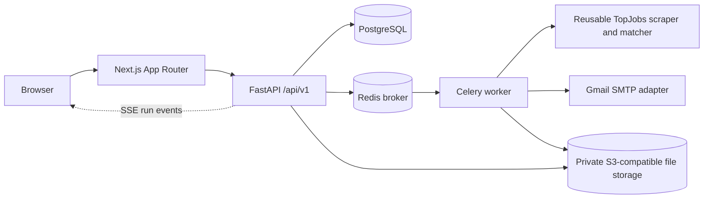

# Target web architecture

## Phase 1 status

This document describes the requested target architecture and the foundation added in Phase 1. The existing Next.js/Supabase application is still present in the working tree; authentication, persistence, and run execution have not yet been migrated to the new PostgreSQL/Celery foundation. Do not treat the Phase 1 Compose stack as a production-ready deployment.

## Existing engine review

- **Scraping:** `src/scraper.py` fetches TopJobs category pages and advert pages with a shared `requests.Session`, retry handling, and BeautifulSoup parsing. It extracts advert IDs, titles, posting dates, employer email, visible text, and image URLs. Optional OCR reads image-based advert text. Selectors and parser details currently live in this module.
- **Matching:** `analyze_job_fit` normalizes text and looks for whole-phrase keyword hits across each profile. Title hits score 4 points; additional profile-title hits and description hits score 2 each; junior/entry-level hints add 1. It applies remote-only, excluded-role, seniority, and minimum-score rules and returns a profile plus a reason when skipped.
- **Email drafting/sending:** the tracked desktop `src/mailer.py` builds a subject and personalized message from the selected profile, matched keywords, and sender contact details; it can render a PDF cover letter. Its SMTP function sends attachments over SSL and returns a success/error tuple. The old desktop workflow adds local CSV and credential-store handling around that functionality.
- **Current web adapter:** `src/web_engine.py` invokes the scraper and matcher and reports each processed job through callbacks. In this working tree, the former desktop mailer, account services, and SQLite history files are deleted; their original versions remain in Git history. The current FastAPI implementation still uses its existing Supabase integration and in-process run handling.

## Target component flow



The API owns authentication, authorization, validation, and all user-scoped database access. A queued task performs scraping and matching on the worker, writes durable run state and logs to PostgreSQL, and publishes progress for the API's SSE endpoint. Email delivery is behind a mailer interface; the initial adapter uses Gmail App Password SMTP. Review/dry-run is the default, with sending gated by explicit approval and an opt-in setting.

## Data model foundation

The initial Alembic migration creates users and hashed-token sessions; sender profiles; encrypted Gmail credentials; resume profiles and file metadata; shared scraped jobs; per-user applications; settings; durable runs and run logs; and audit records. A unique `(user_id, job_id)` constraint makes applications idempotent. A partial unique index allows only one queued/running/cancelling run per user. Composite user/run and user/profile foreign keys prevent cross-user file/log associations. Jobs and applications have indexes for date, score, status, profile, and skip-reason filtering.

Resume and generated-file bytes are intentionally not stored in PostgreSQL. `object_key` and `cover_letter_path` are storage references; the storage adapter and deletion/export flow are later-phase work. Database access must always scope user-owned records by the authenticated user. The database role used by the app should not be exposed to the browser.

## Development foundation

`compose.yaml` starts PostgreSQL, Redis, a one-shot Alembic migration, FastAPI, a Celery worker, and the Next.js frontend. Copy `.env.example` to `.env`, replace placeholder values where applicable, then run:

```bash
docker compose up --build
```

The local PostgreSQL password default is for development only. No production secret should use that value. At this phase the worker has no application tasks registered and API routes still use the existing persistence implementation; this is intentionally a foundation for subsequent phases, not an end-to-end usable deployment.
